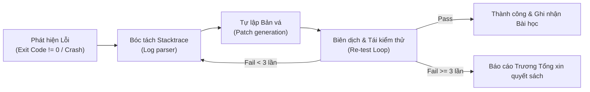

# 🔄 SELF-HEALING-LOOP-XSKILL — VÒNG LẶP TỰ CHỮA LÀNH KHÉP KÍN

> **Triết lý vận hành tự chủ cao cấp:**  
> *"Lỗi sinh ra ở đâu, triệt tiêu ở đó. Không mang lỗi dang dở lên làm phiền Trương Tổng trừ khi gặp bế tắc bất khả kháng."*

---

## 1. QUY TRÌNH 4 BƯỚC TỰ PHỤC HỒI (SELF-HEALING PIPELINE)

### Bước 1: Bắt trọn vẹn Stacktrace & Mã Lỗi
* Không suy đoán chung chung. Lấy trực tiếp `stderr` và file log cụ thể (ví dụ `output/remotecode_err.log`, Gradle error log, compiler error).

### Bước 2: Phân loại nguyên nhân gốc (Root Cause Classification)
* **Xung đột môi trường / Cổng mạng (Port conflict / Process lock):** Tự động truy tìm PID qua `lsof -i :PORT` và giải phóng an toàn.
* **Lỗi phụ thuộc (Missing package / Typo module):** Tự động cài đặt hoặc điều chỉnh import path `.js` / `.ts`.
* **Lỗi TypeScript compilation:** Đọc dòng chính xác, sửa kiểu dữ liệu hoặc thêm type guard.
* **Lỗi kết nối CSDL / Mạng:** Tự động kích hoạt chế độ Fallback bền vững (ví dụ SQLite cục bộ khi Postgres chưa online).

### Bước 3: Áp dụng Bản vá & Tái thực thi (Tối đa 3 vòng lặp)
* Sau khi chỉnh sửa, chạy lại ngay lệnh kiểm thử (`npm run typecheck`, `npm test`, hoặc lệnh build).
* Mỗi vòng lặp ghi nhận: `[Attempt 1/3: Failed -> Patched -> Attempt 2/3: Passed]`.

### Bước 4: Chuyển giao tri thức vào Bảo tàng Cạm bẫy
* Khi chữa lành thành công, lập tức gửi tóm tắt nguyên nhân và cách khắc phục sang `pitfall-memory-xskill` để ghi nhớ vĩnh viễn.
